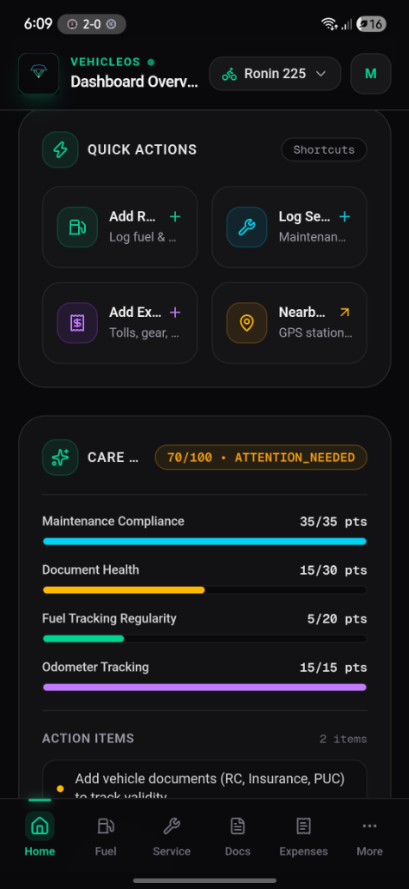
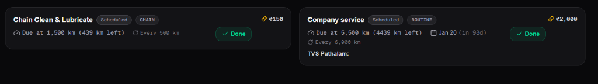
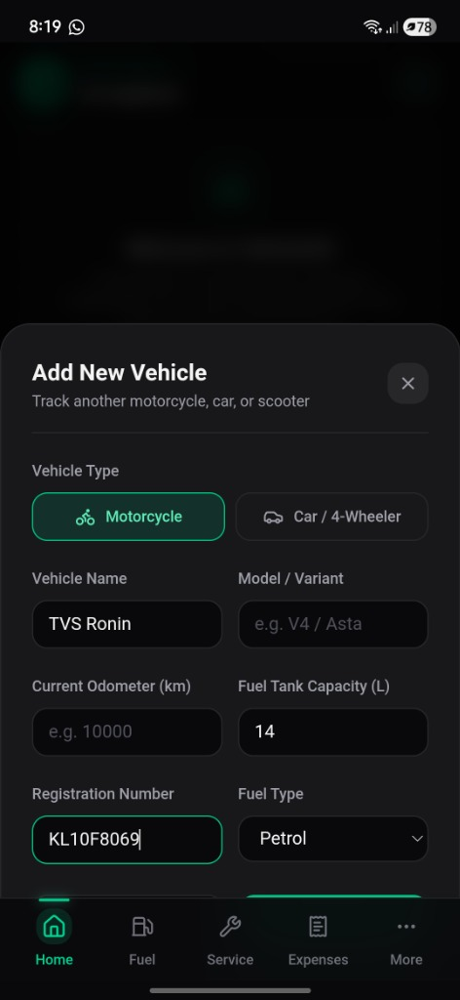
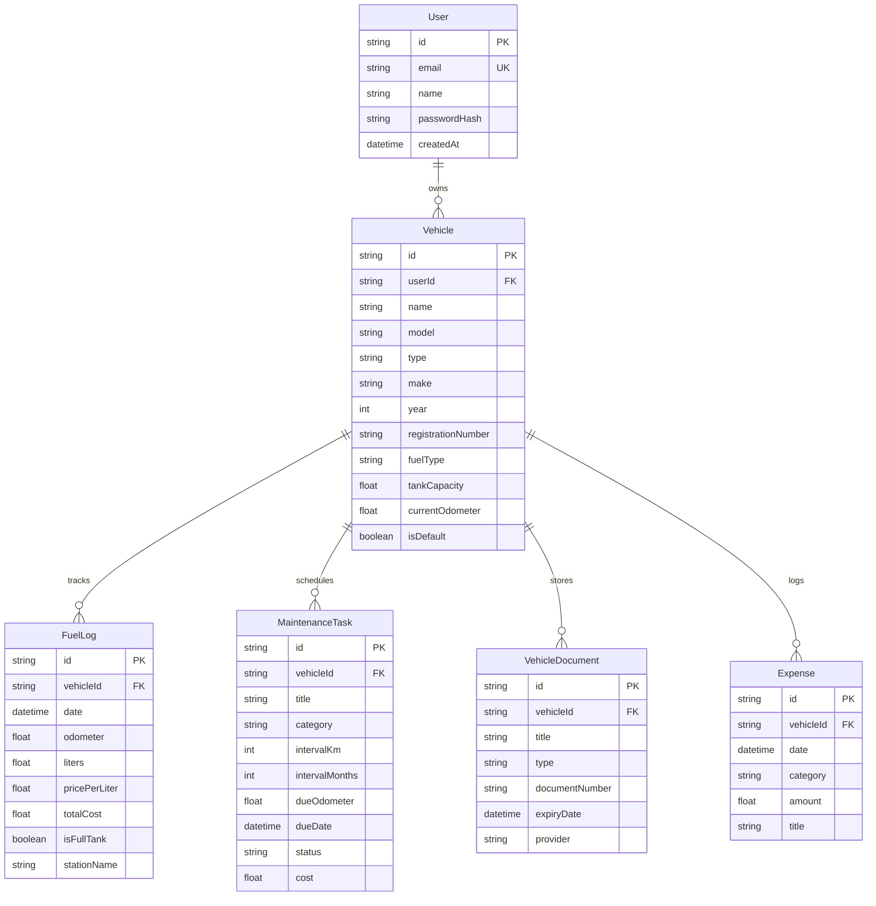

<div align="center">


# VehicleOS

### Smart Vehicle Telemetry, Fuel Intelligence & Maintenance Companion

[](https://nextjs.org/)
[](https://react.dev/)
[](https://www.typescriptlang.org/)
[](https://tailwindcss.com/)
[](https://www.prisma.io/)
[](https://www.postgresql.org/)
[](https://web.dev/progressive-web-apps/)
[](LICENSE)

<p align="center">
  A mobile-first, installable Progressive Web App (PWA) designed to replace fragmented vehicle ownership spreadsheets, glovebox papers, and reminder apps with real-time mileage analytics, predictive dual-trigger maintenance forecasting, compliance document monitoring, and multi-vehicle garage management.
</p>

[**Explore Live Demo »**](https://vehicle-os-beta.vercel.app) &nbsp;&bull;&nbsp;
[**Report Issue**](https://github.com/Ramzin007/vehicle-os/issues) &nbsp;&bull;&nbsp;
[**Request Feature**](https://github.com/Ramzin007/vehicle-os/issues)

</div>

---

## 📱 Visual Showcase & Interface

<div align="center">
  <table>
    <tr>
      <td align="center" width="38%">
        
        <br />
        <sub><b>Live Mobile Dashboard</b><br />Active Vehicle, Quick Actions & Care Score</sub>
      </td>
      <td align="center" width="62%">
        
        <br />
        <sub><b>Predictive Service Schedule</b><br />Dual km & calendar triggers with urgency badges</sub>
        <br /><br />
        
        <br />
        <sub><b>Multi-Vehicle Garage</b><br />Add motorcycles, cars, & custom specs</sub>
      </td>
    </tr>
  </table>
</div>

---

## 🚀 Key Architectural Features

### 1. ⚡ Fuel Telemetry & Real-World Economy Engine (`/fuel`)
* **Rolling Fuel Economy Calculation**: Computes true consumption in `km/L`, `L/100km`, and `MPG` across consecutive full tank refills.
* **Automatic Missed-Refill Reset**: Gracefully isolates gaps in fuel records without skewing aggregate statistics.
* **Cost-Per-Kilometer Analysis**: Tracks running expenditure (`₹/km`), total spent, and average price per liter across fueling stations.
* **Refill Telemetry**: Records odometer reading, volume in liters, fuel brand (IndianOil, BPCL, HPCL, Shell), partial vs. full tank, and custom notes.

### 2. 🛠 Predictive Dual-Trigger Maintenance (`/maintenance`)
* **Dual Expiry Conditions**: Tasks automatically forecast when due based on whichever threshold arrives first: **Distance ($km$)** or **Calendar Time ($days$)**.
* **Real-Time Urgency Classification**:
  - `DUE SOON`: Within $300\text{ km}$ or $14\text{ days}$.
  - `OVERDUE`: Passed threshold date or odometer reading.
  - `SCHEDULED`: Healthy upcoming interval.
  - `COMPLETED`: Archived with service date, odometer reading, and syncs to expenses.
* **One-Tap Completion & Cost Sync**: Completing a maintenance task automatically registers a synchronized service expense entry in the financial ledger.

### 3. 🏆 Algorithmic Vehicle Care Score™ ($0 - 100$)
A composite, weighted mathematical model evaluating vehicle health and compliance:

$$\text{Care Score} = M_{35} + D_{30} + F_{20} + O_{15}$$

| Component | Max Points | Evaluation Criteria |
| :--- | :---: | :--- |
| **Maintenance Compliance** | **35 pts** | Deducts 12 pts per overdue task and 4 pts per task due soon. |
| **Document Health** | **30 pts** | Validates active certificates; penalizes expired ($-15$) or expiring soon ($-5$) docs. |
| **Fuel Regularity** | **20 pts** | Tracks recency of refill records ($<30\text{ days} = 20\text{ pts}$, $>45\text{ days} = 10\text{ pts}$). |
| **Odometer Freshness** | **15 pts** | Rewards active telemetry logging vs stale odometer readings. |

* **Rating Tiers**: `EXCELLENT` ($90 - 100$), `GOOD` ($75 - 89$), `ATTENTION NEEDED` ($55 - 74$), `CRITICAL` ($< 55$).

### 4. 📑 Compliance & Document Vault (`/documents`)
* **Official Certificate Monitoring**: Dedicated compliance tracking for Registration Certificate (RC), Comprehensive Insurance, Pollution Under Control (PUC), and Driving License.
* **Proactive Expiry Badges**: Dynamic countdown badges alerting the owner before fines or lapse occur.

### 5. 📍 GPS Petrol Station Finder (`/stations`)
* **Browser Geolocation API**: Pinpoints the user's real-time coordinates.
* **Overpass API Integration**: Queries OpenStreetMap within a $5\text{ km}$ bounding radius for fuel stations.
* **Turn-by-Turn Routing**: One-click Google Maps routing with fuel brand indicators (IndianOil, BPCL, HPCL, Shell, Nayara).

### 6. 🏍 Multi-Vehicle Garage (`/more`)
* Seamlessly manage multiple vehicles across motorcycles, cars, and scooters.
* One-click active vehicle switcher persisted via vehicle-scoped `sessionStorage` for instantaneous ($0\text{ ms}$) UI hydration.
* Full JSON telemetry backup/export and profile settings.

### 7. 📱 Progressive Web App (PWA)
* Standalone mobile display mode with custom cyber-emerald app icon and splash theme `#09090b`.
* Offline caching and Service Worker registration (`sw.js`).
* Native bottom bar navigation on mobile with desktop sidebar on wider displays.

---

## 🛠 Tech Stack

| Layer | Technologies |
| :--- | :--- |
| **Frontend Framework** | [Next.js 16.3](https://nextjs.org/) (App Router, Turbopack, Server & Client Components) |
| **UI Library** | [React 19](https://react.dev/), [Tailwind CSS v4](https://tailwindcss.com/) |
| **Icons & Design** | [Lucide React](https://lucide.dev/), Custom Cyber-Automotive Vector Emblem |
| **Database & ORM** | [Prisma ORM 6.12](https://www.prisma.io/), [PostgreSQL](https://www.postgresql.org/) ([Supabase](https://supabase.com/) / [Neon](https://neon.tech/)) |
| **Authentication** | JWT via [jose](https://github.com/panva/jose) & HTTP-only cookies, [bcryptjs](https://github.com/dcodeIO/bcrypt.js) |
| **Validation** | [Zod 4.4](https://zod.dev/) |
| **Geolocation** | Browser Geolocation API + OpenStreetMap Overpass API |
| **PWA Engine** | Service Worker, Web App Manifest, Apple Touch Icons |

---

## 📁 Project Architecture & File Organization

```
vehicle-os/
├── app/
│   ├── api/
│   │   ├── auth/              # JWT authentication (login, register, me, logout)
│   │   ├── documents/         # Certificate compliance vault API
│   │   ├── expenses/          # Categorized financial ledger API
│   │   ├── fuel/              # Fuel refill logs & economy engine API
│   │   ├── maintenance/       # Service tasks & completion API
│   │   ├── stations/          # GPS nearby petrol stations API
│   │   └── vehicles/          # Multi-vehicle garage management API
│   ├── documents/             # Documents page
│   ├── expenses/              # Expense tracking & category breakdown page
│   ├── fuel/                  # Fuel logs, economy graphs & stats page
│   ├── maintenance/           # Service schedule & interval cards page
│   ├── more/                  # Garage settings, specs & JSON export page
│   ├── stations/              # Interactive nearby fuel stations finder
│   ├── login/ & register/     # User authentication flows
│   ├── icon.svg               # Dynamic Next.js vector app icon & favicon
│   ├── layout.tsx             # Root viewport, metadata & Geist typography
│   ├── manifest.ts            # Web App Manifest definition
│   └── page.tsx               # Mobile-first Command Center Dashboard
├── components/
│   ├── context/
│   │   └── vehicle-context.tsx# Global vehicle state provider & cache sync
│   ├── dashboard/             # VehicleCard, StatCard, QuickActions
│   ├── layout/                # AppShell, TopBar, BottomNav, DesktopSidebar
│   ├── modals/                # AddVehicle, AddRefuel, AddService, AddExpense, AddDoc
│   ├── pwa/                   # PwaRegister service worker loader
│   └── ui/                    # VehicleOsLogo vector identity component
├── docs/
│   └── screenshots/           # Documentation images & mobile preview
├── lib/
│   ├── auth.ts                # JWT token signing, verification & password hashing
│   ├── calculations.ts        # Pure calculation engine (Mileage, Care Score, Expenses)
│   ├── calculations.test.ts   # Automated unit tests for telemetry math
│   ├── prisma.ts              # Global Prisma Client singleton
│   └── validations.ts         # Zod schemas for input validation
├── prisma/
│   └── schema.prisma          # PostgreSQL relational schema
└── public/
    ├── icons/                 # PWA icons (192x192, 512x512, apple-touch-icon)
    ├── favicon.ico & svg      # Multi-resolution favicons
    └── sw.js                  # Service Worker for offline PWA caching
```

---

## 🗄 Database Schema (Entity Relationship)



---

## 📡 REST API Reference

| Method | Endpoint | Description | Auth Required |
| :--- | :--- | :--- | :---: |
| `POST` | `/api/auth/register` | Create a new user account | No |
| `POST` | `/api/auth/login` | Sign in & receive HTTP-only JWT cookie | No |
| `POST` | `/api/auth/logout` | Revoke session & clear cookie | Yes |
| `GET` | `/api/auth/me` | Fetch currently authenticated user | Yes |
| `GET` | `/api/vehicles` | List all vehicles owned by user | Yes |
| `POST` | `/api/vehicles` | Add a new vehicle to the garage | Yes |
| `PATCH` | `/api/vehicles` | Update vehicle specs or odometer | Yes |
| `DELETE`| `/api/vehicles` | Remove vehicle and cascade telemetry | Yes |
| `GET` | `/api/fuel?vehicleId={id}` | Get fuel refills with calculated economy | Yes |
| `POST` | `/api/fuel` | Log a new fuel refill entry | Yes |
| `GET` | `/api/maintenance?vehicleId={id}` | List service tasks & due status | Yes |
| `POST` | `/api/maintenance` | Create a new scheduled maintenance task | Yes |
| `PATCH` | `/api/maintenance` | Mark task completed & sync expense | Yes |
| `GET` | `/api/documents?vehicleId={id}` | List vehicle compliance documents | Yes |
| `POST` | `/api/documents` | Store new document with expiry date | Yes |
| `GET` | `/api/expenses?vehicleId={id}` | Retrieve categorized expense ledger | Yes |
| `POST` | `/api/expenses` | Record manual vehicle expense | Yes |
| `GET` | `/api/stations?lat={lat}&lon={lon}`| Query nearby fuel stations via GPS | No |

---

## 📦 Sample Data Payloads

<details>
<summary><b>1. Fuel Refill Entry & Enriched Telemetry Output (JSON)</b></summary>

```json
{
  "id": "cly23489x0001",
  "vehicleId": "cly10928a0001",
  "date": "2026-10-14T08:30:00.000Z",
  "odometer": 5420.0,
  "liters": 12.5,
  "pricePerLiter": 102.4,
  "totalCost": 1280.0,
  "isFullTank": true,
  "missedRefuel": false,
  "stationName": "IndianOil AutoCare",
  "calculatedDistance": 482.0,
  "calculatedEconomy": 38.6
}
```
</details>

<details>
<summary><b>2. Maintenance Task with Dual Triggers (JSON)</b></summary>

```json
{
  "id": "clm98765b0002",
  "vehicleId": "cly10928a0001",
  "title": "Engine Oil & Filter Replacement",
  "category": "OIL_CHANGE",
  "intervalKm": 4000,
  "intervalMonths": 6,
  "dueOdometer": 6000.0,
  "dueDate": "2026-12-15T00:00:00.000Z",
  "status": "DUE_SOON",
  "cost": 1850.0
}
```
</details>

<details>
<summary><b>3. Care Score Computed Result (JSON)</b></summary>

```json
{
  "score": 88,
  "rating": "GOOD",
  "color": "#06b6d4",
  "maintenancePoints": 35,
  "documentPoints": 25,
  "refuelPoints": 20,
  "odometerPoints": 15,
  "recommendations": [
    "Insurance certificate expiring in 22 days. Renew to maintain compliance."
  ]
}
```
</details>

---

## 🚦 Getting Started (Local Setup)

### Prerequisites
- **Node.js**: `v18.17.0` or higher
- **Package Manager**: `npm`, `pnpm`, or `yarn`
- **Database**: PostgreSQL (e.g. [Supabase](https://supabase.com/) or local PostgreSQL)

### 1. Clone the Repository
```bash
git clone https://github.com/Ramzin007/vehicle-os.git
cd vehicle-os
```

### 2. Install Dependencies
```bash
npm install
```

### 3. Configure Environment Variables
Create a `.env` file in the root directory:
```env
# Database Connections
DATABASE_URL="postgresql://postgres:[PASSWORD]@[HOST]:6543/postgres?pgbouncer=true"
DIRECT_URL="postgresql://postgres:[PASSWORD]@[HOST]:5432/postgres"

# Authentication Security
JWT_SECRET="your-super-secure-random-32-byte-secret-key"
```

### 4. Push Prisma Schema to Database
```bash
npx prisma db push
```

### 5. Run Development Server
```bash
npm run dev
```

Open [http://localhost:3000](http://localhost:3000) on your desktop or mobile browser.

### 6. Run Telemetry Tests
```bash
npx tsx lib/calculations.test.ts
```

### 7. Production Build Verification
```bash
npm run build
```

---

## 🚢 Deployment (Vercel)

1. Push your repository to GitHub.
2. Import the project into [Vercel](https://vercel.com).
3. Set your environment variables in the Vercel Project Settings:
   - `DATABASE_URL`
   - `DIRECT_URL`
   - `JWT_SECRET`
4. Deploy! Vercel will automatically build the Next.js App Router project and run `prisma generate` during `postinstall`.

---

## 📄 License

This project is licensed under the **MIT License** — see the [LICENSE](LICENSE) file for details.

---

<div align="center">
  <sub>Built with precision for automotive enthusiasts and everyday commuters.</sub>
  <br />
  <b>VehicleOS &copy; 2026</b>
</div>
